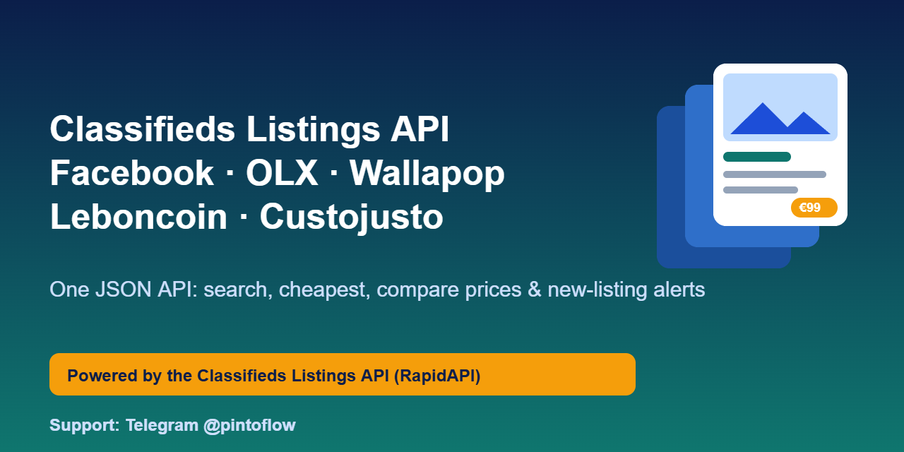
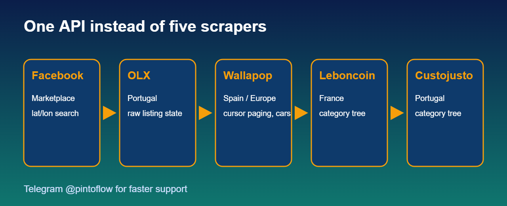

<p align="center"></p>

<p align="center">
<a href="https://rapidapi.com/belchiorarkad-FqvHs2EDOtP/api/classifieds-listings-api"><b>Get your API key on RapidAPI</b></a> ·
<a href="https://t.me/pintoflow">Telegram @pintoflow</a> ·
<a href="#example-projects">Example projects</a>
</p>

> **Free plan available.** Subscribe on RapidAPI: [https://rapidapi.com/belchiorarkad-FqvHs2EDOtP/api/classifieds-listings-api](https://rapidapi.com/belchiorarkad-FqvHs2EDOtP/api/classifieds-listings-api)



## Example projects

Open-source projects built on this API (MIT):

| Project | What it does |
|---|---|
| [marketplace-price-comparison-cli](https://github.com/BelNaruto/marketplace-price-comparison-cli) | Python CLI: per-source min/avg/max prices, cheapest listings, and a watch mode that prints only new listings |
| [classifieds-deal-alert-telegram-bot](https://github.com/BelNaruto/classifieds-deal-alert-telegram-bot) | Zero-dependency Node.js Telegram bot: search, cheapest, compare and new-listing alerts |
| [second-hand-price-dashboard](https://github.com/BelNaruto/second-hand-price-dashboard) | Web dashboard with a price-by-source chart and a gallery of the cheapest listings |

---

# Classifieds Listings API — Facebook Marketplace, OLX, Wallapop, Leboncoin & Custojusto in One REST API

> ## ⚡ Need a FASTER reply? Contact support on Telegram: **[@pintoflow](https://t.me/pintoflow)**
> Questions, bugs, a new source or country, custom fields, higher limits — message **Telegram @pintoflow** and you will get the quickest response. RapidAPI messages are answered more slowly.

---

## What is the Classifieds Listings API?

**Classifieds Listings API** searches and tracks second-hand and classified listings across **five marketplaces** through **one request shape and one normalized JSON listing object**:

| Source | `source` value | Region |
|---|---|---|
| **Facebook Marketplace** | `facebook` | Worldwide (lat/lon) |
| **OLX** | `olx` | Portugal and other OLX markets |
| **Wallapop** | `wallapop` | Spain and Europe |
| **Leboncoin** | `leboncoin` | France |
| **Custojusto** | `custojusto` | Portugal |

Instead of writing and maintaining five scrapers (each with its own anti-bot protection, page structure and price format), you call one API and get the same fields everywhere: title, price, currency, images, location, seller, posted date, category and the original listing URL.

**Perfect for:** price comparison sites, resale and flipping tools, deal-alert bots, market research, arbitrage between countries, inventory sourcing, valuation tools for used goods, and AI agents that need live second-hand prices.

## Key features

- **One schema for five marketplaces** — the same `Listing` object from every source
- **Multi-source search** — fan one query out to any combination of sources in parallel and get one merged, sorted list
- **Cheapest finder** — "what is the cheapest iPhone 13 right now, anywhere"
- **Price compare** — per-source `count / min / max / avg` plus an overall roll-up: "where is it cheapest"
- **Full listing detail** — fetch one listing's full record, including all images and seller info
- **Price alerts** — save a search once; new matches are re-checked on a schedule and POSTed to your webhook
- **Per-source extras** — Leboncoin and Custojusto category trees, OLX raw listing state, Wallapop vehicles search
- **Partial results by design** — if one source fails you still get the others, plus an `errors` array
- **Cursor pagination** for Wallapop and `page` / `limit` for everyone

## Quick start

1. Subscribe (free plan available): [https://rapidapi.com/belchiorarkad-FqvHs2EDOtP/api/classifieds-listings-api](https://rapidapi.com/belchiorarkad-FqvHs2EDOtP/api/classifieds-listings-api)
2. Copy your key and call any endpoint:

**curl**

```bash
curl -H "X-RapidAPI-Key: $RAPIDAPI_KEY" -H "X-RapidAPI-Host: classifieds-listings-api.p.rapidapi.com" \
  "https://classifieds-listings-api.p.rapidapi.com/api/search/cheapest?query=iphone+13&sources=olx,wallapop&maxPrice=400&limit=10"
```

**JavaScript (Node 18+)**

```js
const r = await fetch('https://classifieds-listings-api.p.rapidapi.com/api/search/compare?query=iphone+13&limit=20', {
  headers: { 'X-RapidAPI-Key': process.env.RAPIDAPI_KEY, 'X-RapidAPI-Host': 'classifieds-listings-api.p.rapidapi.com' },
});
const { data } = await r.json();
console.log(data.overall, Object.keys(data.bySource));
```

**Python**

```python
import os, requests
H = "classifieds-listings-api.p.rapidapi.com"
r = requests.get(f"https://{H}/api/search/cheapest",
                 headers={"X-RapidAPI-Key": os.environ["RAPIDAPI_KEY"], "X-RapidAPI-Host": H},
                 params={"query": "sofa", "sources": "olx,custojusto", "limit": 10})
for l in r.json()["data"]["listings"]:
    print(l["price"], l["currency"], l["source"], l["title"], l["url"])
```

## Endpoints

| Group | Endpoint | What it does |
|---|---|---|
| Service & Sources | `GET /health` | Uptime check (no key needed on the origin) |
| Service & Sources | `GET /api/sources` | Supported sources with id, label and country |
| Search Listings | `GET /api/search/{source}` | Search one source: `query, category, location, minPrice, maxPrice, page, limit, sortBy, cursor` |
| Search Listings | `GET /api/search/{source}/listing/{id}` | Full detail of one listing |
| Search Listings | `GET /api/search` | Search several sources at once, merged and sorted |
| Search Listings | `GET /api/search/cheapest` | Same as above, sorted by price ascending |
| Search Listings | `GET /api/search/compare` | Per-source price statistics and an overall roll-up |
| Source Extras | `GET /api/sources/leboncoin/categories` | Leboncoin category tree |
| Source Extras | `GET /api/sources/custojusto/categories` | Custojusto breadcrumb / category tree |
| Source Extras | `GET /api/sources/olx/rawState` | Full raw OLX listing record |
| Source Extras | `GET /api/sources/wallapop/cars` | Vehicles-only search on Wallapop |
| Price Alerts | `POST /api/alerts` | Create an alert (`query` required; `sources, minPrice, maxPrice, webhookUrl` optional) |
| Price Alerts | `GET /api/alerts` · `GET /api/alerts/{id}` | List or fetch alerts |
| Price Alerts | `GET /api/alerts/{id}/matches` | Stored matches (`?live=1` runs the query now) |
| Price Alerts | `DELETE /api/alerts/{id}` | Delete an alert |

Full parameter reference, response shapes and examples are in the **Docs tab on RapidAPI**: [https://rapidapi.com/belchiorarkad-FqvHs2EDOtP/api/classifieds-listings-api](https://rapidapi.com/belchiorarkad-FqvHs2EDOtP/api/classifieds-listings-api).

## The Listing object

Every endpoint returns listings in this one shape:

```json
{
  "id": "custojusto:45469559",
  "sourceId": "45469559",
  "source": "custojusto",
  "title": "iPhone 14 Midnight 128GB com Caixa e Pin",
  "description": "iPhone 14 Midnight (Meia-noite)...",
  "price": 300,
  "currency": "EUR",
  "url": "https://www.custojusto.pt/braga/.../iphone-14-midnight-128gb-com-c-45469559",
  "images": ["https://prod-images.custojusto.pt/..."],
  "location": { "district": "Braga", "county": "Esposende" },
  "postedAt": "2026-10-27T13:05:33Z",
  "category": "Telefones e Acessórios",
  "seller": { "name": "filipa07silva", "isCompany": false },
  "attributes": {}
}
```

Every response, success or error, is wrapped as `{ "error": null, "data": ..., "message": "Success" }`.

## Pricing

| Plan | Price | Requests / month |
|---|---|---|
| Basic | Free | 100 |
| Pro | $14.99 | 5,000 |
| Ultra | $49.99 | 25,000 |
| Mega | $149.99 | 100,000 |

Plans and overage rates are always current on the [RapidAPI listing](https://rapidapi.com/belchiorarkad-FqvHs2EDOtP/api/classifieds-listings-api).

## FAQ

**Which marketplaces are supported?** Facebook Marketplace, OLX, Wallapop, Leboncoin and Custojusto. More sources can be added; message Telegram @pintoflow.

**Is the data live?** Yes. Every response is fetched from the marketplaces when you call, not from a stale database.

**What happens if one marketplace is down?** You still get results from the others with HTTP 200, and the failing source is listed in the `errors` array. Leboncoin and Wallapop sit behind anti-bot protection, so an occasional `500/502` is normal: retry.

**Can I get notified about new listings?** Yes: create a price alert with a `webhookUrl`, or poll `/api/alerts/{id}/matches`.

**How do I look up one listing?** Pass the id from a search result's `sourceId` for Wallapop and Facebook. For OLX, Custojusto and Leboncoin pass the listing's full URL path, URL-encoded.

**Do filters mean the same on every site?** `category` and `location` are source-specific (a city name for OLX/Custojusto, a zip or city for Leboncoin, `lat,lon` for Wallapop/Facebook). `minPrice`, `maxPrice`, `page`, `limit` and `sortBy` work everywhere.

**Is this official?** No. It is an unofficial API and is not affiliated with Meta, OLX, Wallapop, Leboncoin or Custojusto. Page structures can change without notice.

## Support

> ## 💬 Questions, a new source, custom endpoints or higher limits? **[Telegram @pintoflow](https://t.me/pintoflow)**

**Keywords:** facebook marketplace api, olx api, wallapop api, leboncoin api, custojusto api, classifieds api, second hand price api, marketplace scraper api, used items price comparison, price alert api, resale price api

## License

MIT for the code in this repository. Use of the API is governed by the RapidAPI terms.
